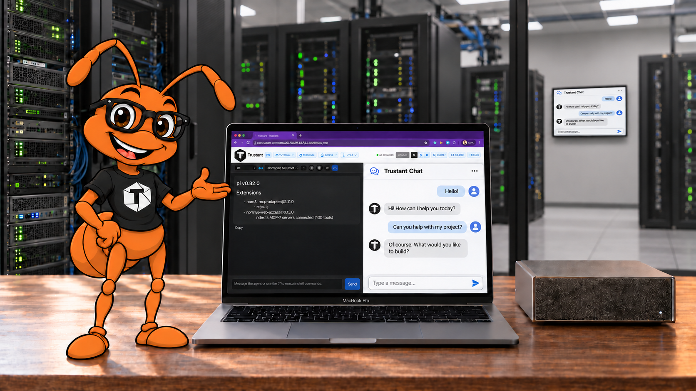

# Trustant

Trustant is a development environment for creating, editing, running, and publishing web applications backed by OpenServerless. It combines a browser UI, the TruACP/Pi coding assistant, Git repositories for application source, and local development services on k3s.

This README is for developers running Trustant from source and contributors navigating the repository.

[](https://trustant.ai/#video?v=demo)

## Quick start

Use the entry point for your host. The scripts install tools and services, configure networking, and start the development server; first startup downloads the pinned serverless package and runtime dependencies. Keep the checkout and its generated configuration on a development machine.

### Windows (PowerShell and WSL2)

Install Git and ensure WSL2 is available (`wsl --version`). The script creates a dedicated `trudev` distribution from Ubuntu 24.04, configures systemd and a user with passwordless sudo, and runs the Linux setup inside it.

```powershell
git clone https://github.com/trustant/trustant.git
cd trustant
.\start.ps1
```

The source stays in the Windows checkout and is accessed through the WSL mount. Follow the printed instructions to enter the distribution or open the UI. See [Windows setup and options](spec/start.md).

### macOS (Lima)

Install Git and Lima. With Homebrew available:

```bash
brew install lima
git clone https://github.com/trustant/trustant.git
cd trustant
./start.sh
```

The script provisions the `trudev` Ubuntu VM, mounts the checkout, runs setup, and starts the development loop inside the VM. The Lima configuration allocates 8 GiB of memory and 60 GiB of disk; allow additional host capacity for the checkout and download cache. See [startup details](spec/start.md).

### Native Ubuntu

Use Ubuntu 24.04 on amd64 or arm64 with systemd and a user with passwordless sudo. Provisioning installs the local serverless cluster on this host.

```bash
git clone https://github.com/trustant/trustant.git
cd trustant
./start.sh
```

The script prepares the host, runs `setup.sh`, then starts `run.sh`. See [native Ubuntu setup](spec/start.md#native-ubuntu-linux).

### Open the UI

Open the URL printed by the development loop. Choose a provider and model, then create or import an application from the app list. Provider credentials are configured in the UI. The app workbench provides the assistant, preview, file viewer, terminal, and application configuration.

`start.sh` initializes the runtime source submodules (`mcp` and `acp`, including nested dependencies). To populate every submodule for repository work:

```bash
git submodule update --init --recursive
```

Startup creates `.env` when it is absent; existing values are validated by setup. See [configuration](#configuration) before customizing it.

## Common tasks

### Restart development or open VS Code

| Task | macOS | Windows PowerShell | Native Ubuntu |
|---|---|---|---|
| Start environment and development loop | `./start.sh` | `.\start.ps1` | `./start.sh` |
| Prepare without starting the loop | `./start.sh -n` | `.\start.ps1 -n` | `./start.sh -n` |
| Open VS Code in the environment | `./start.sh -v` | `.\start.ps1 -v` | Open the local checkout |
| Stop the VM or distribution | `./start.sh -s` | `.\start.ps1 -s` | Not applicable |

Run `./run.sh` from the checkout **inside Ubuntu** to restart only the development loop. On macOS, `./ssh.sh ./run.sh` runs it in the VM. Press Ctrl+C to stop the loop. `run.sh` rejects unsupported hosts and frees ports 8910, 5173, and 4096 before starting services.

`./ssh.sh -d` opens a development shell in the macOS VM. The `-p` and `-i` modes access the installed Trustant user and the deployed container; see [SSH access](spec/start.md#sshsh-has-three-access-modes).

The `-k` startup option destroys the VM or unregisters the WSL distribution and removes its filesystem. Use it only when you intend to discard that environment. Native Linux refuses the VM stop and destroy options.

### Update an existing checkout

Stop the development loop and review local changes before updating. In the development environment, pull the branch you use, then refresh submodules and setup:

```bash
git status --short
git pull --ff-only --recurse-submodules
git submodule update --init --recursive
./setup.sh
./run.sh
```

`setup.sh` installs and verifies the toolchain and MCP servers in Ubuntu. Its runtime pins come from the repository and [acp/pi.version](acp/pi.version). On macOS, enter the VM with `./ssh.sh -d` first; on Windows, use the shell command printed by `start.ps1`.

### Save and publish an application

Use the app's Git controls to save source changes and push to its configured Git remote. Configure production environment values before deploying to an OpenServerless destination.

With license enforcement enabled (the default):

| Operation | License checks |
|---|---|
| Git push or force-push (`/api/publish/push`, `/api/publish/force-push`) | None |
| Development deployment (`/api/git/deploy`) | None |
| Remote production deployment (`/api/publish/remote`) | Valid license and destination host |
| Application provisioning (`/api/publish/provision`) | Valid license and configured license host |

Install a license and configure provisioning settings on Configure. Verification uses an embedded Ed25519 public key. Destination matching compares normalized `scheme://host[:port]` values without wildcards. The literal local hostnames `miniops.me`, `localhost`, `127.0.0.1`, and `::1` bypass only the host check; production operations still require a valid license.

The backend returns license errors with the `License required` or `Host not licensed` prefix, which the UI uses to open its license dialog. See [publishing](spec/6-publish.md), [provisioning](spec/user_provisioning.md), and [license behavior](spec/14-license.md). License issuance is maintained in the separate installer repository.

## Configuration

### Server environment

The Go server loads a mandatory `.env` from its current directory. Startup seeds it from [.env.dist](.env.dist); [setup.sh](setup.sh) validates existing values. The template is the starting point for manual setup, not a provider credential file.

| Variable | Purpose |
|---|---|
| `WORKSPACE_DIR` | Durable configuration and bare application repositories under `workspace/<name>/` |
| `WORKBENCH_DIR` | Active application checkouts under `<name>/` |
| `OLLAMA_ENDPOINT` | Ollama service endpoint |
| `AIP_REGISTER_URL` | Registration UI base URL |
| `AIP_BASE_URL` | Credits and top-up API base URL |
| `GIT_USER`, `GIT_EMAIL` | Git identity defaults validated by setup; app configuration also carries Git identity |
| `GITHUB_TOKEN` | Optional helper credential; the template placeholder is not a working token |

The first five variables are required by the server's `loadEnv` function in [preflight.go](preflight.go). `OPENAI_BASE_URL` and `OPENAI_API_KEY` are not mandatory server variables; the selected provider is stored in workspace configuration and credentials are propagated to the assistant runtime.

An optional `.env.default` seeds the predefined environment variable palette in Configure. It is separate from server `.env` and per-app environment files. See [configuration behavior](spec/2a-config.md).

### Application configuration and storage

Trustant merges the defaults in root [trustant.json](trustant.json) with user configuration in `$WORKSPACE_DIR/trustant.json`. Provider settings, selected model, applications, and license settings persist in the workspace layer. Each app has separate development and production environment maps.

- `$WORKSPACE_DIR/workspace/<name>/` is the durable **bare Git repository**.
- `$WORKBENCH_DIR/<name>/` is its **active checkout**. Launch restores missing checkouts and regenerates managed configuration, including environment files.

Save source changes through the app's Git workflow. Keep credentials out of source repositories. See [repository management](spec/2-repo.md), [launch lifecycle](spec/4-launch.md), [managed files](spec/13-gitignore.md), and [Pi runtime](spec/trustant-pi-runtime.md).

### Hostnames and access

The Go listener on `:8910` dispatches by the first hostname label, as implemented in [middleware.go](middleware.go):

| Host | Destination |
|---|---|
| `trustant.<domain>` | Trustant UI and Go API |
| `truacp.<domain>` | TruACP assistant on `127.0.0.1:4096` |
| `vite.<domain>` | Vite preview on `127.0.0.1:5173` |
| Registered application name | That application's development service |
| Unknown label | HTTP 400 with a suggested Trustant URL |

Requests using `localhost`, an IPv4 address, or a hostname without a dot receive an HTTP 307 redirect to the Trustant FQDN. Use the printed FQDN for browser access and hostname-routing checks. These surfaces use separate hostnames.

Local administrator authentication is optional and disabled by default. See [authentication scope and configuration](spec/authentication.md) before exposing the environment outside your development machine.

## Contributing and testing

Read [AGENTS.md](AGENTS.md) for repository instructions and [CONTRIBUTING.md](CONTRIBUTING.md) for contribution requirements, including the contributor agreement. Intended behavior is described under [spec/](spec/); flag disagreements with the implementation when making changes.

The backend uses one root Go package with feature files such as [launch.go](launch.go), [configure.go](configure.go), and [publish.go](publish.go). API routes are registered in [main.go](main.go); refer there for the current route inventory. Responses include JSON, progress event streams, and terminal WebSockets.

The `web/` UI uses HTML and JavaScript with Tailwind. During development the server serves it from disk, so browser reloads pick up frontend edits. Air watches root Go source and version text; see [.air.toml](.air.toml). Production builds embed UI assets and app instructions, while still relying on the external runtime tools and services.

### Local checks

Run Go checks in the prepared Ubuntu environment. `go.mod` declares the required Go version. A clean checkout lacks `_build.txt`, which `main.go` embeds. `run.sh` generates it before starting Air; to run tests without starting services, create local test metadata first:

```bash
if [ ! -f _build.txt ]; then
  printf 'Version: %s\nBuild: local-test\nBranch: development\nStream: development\n' "$(cat version.txt)" > _build.txt
fi
go test ./...
```

The file is Git-ignored. Existing metadata is preserved by this example.

The lightweight Node checks use the built-in test runner:

```bash
npm run test:tutorial
node --test tests/issue98-session-tree.test.mjs
```

[package.json](package.json) also defines `test:e2e-providers` and the `e2e:*` scenarios. Cluster E2E tests launch applications and can invoke model providers; review their requirements and side effects before running them. See [E2E guide](spec/8-e2e.md) and [issue 98 scenario](tests/issue98-e2e.md).

### Submodules and releases

[.gitmodules](.gitmodules) declares five direct submodules: `acp`, `mcp`, `oplugins`, `oplugins-truinst`, and `skills`. `acp` contains the TruACP runtime and its nested Pi ACP dependency. Follow each affected submodule's own instructions.

Release tooling is documented in [spec/build.md](spec/build.md). `build.sh --tag` and `--build` can replace local tags, update `oplugins-truinst/opsroot.json`, and attempt a commit, including with `--no-deploy`. `hotfix.sh` can replace tags and patch the live StatefulSet; a regular redeploy restores the image from `opsroot.json`. Buildx modes push images, and `publish.sh` pushes Git refs. Review the script before using a release command.

[openserverless-instructions.md](openserverless-instructions.md), [openserverless-contract.md](openserverless-contract.md), and [app-agents.md](app-agents.md) are product assets supplied to generated applications. Repository development instructions live in [AGENTS.md](AGENTS.md).

## Limits and troubleshooting

- The supported source-development path runs the toolchain on Ubuntu, directly or through Lima/WSL2. Running the Go server alone does not provision the cluster, assistant, or MCP services.
- Setup needs network access for pinned packages and dependencies. Model inference, Git hosting, and remote deployments depend on their configured services.
- On native Linux, a serverless package version mismatch can prompt to purge and reinstall the cluster package, removing cluster data. Read the prompt before accepting; see [startup behavior](spec/start.md).
- If compilation reports a missing `_build.txt`, use the test metadata step above or the normal `run.sh` development loop.
- If a hostname redirects unexpectedly or returns 400, use the FQDN printed by startup and check the routing table above.
- For setup, runtime, or deployment failures, consult [startup](spec/start.md), [setup](spec/setup.md), [development loop](spec/run.md), and [publishing](spec/6-publish.md).

This README's commands were reviewed against the scripts. Full provisioning, model inference, and publication still require verification on the target host and configured services.

## Help and license

Report reproducible problems in the [Trustant issue tracker](https://github.com/trustant/trustant/issues), including the relevant version, host platform, and sanitized error output. For contribution questions, follow [CONTRIBUTING.md](CONTRIBUTING.md).

See [LICENSE](LICENSE), [NOTICE](NOTICE), and [DEPS](DEPS) for licensing and third-party notices.
