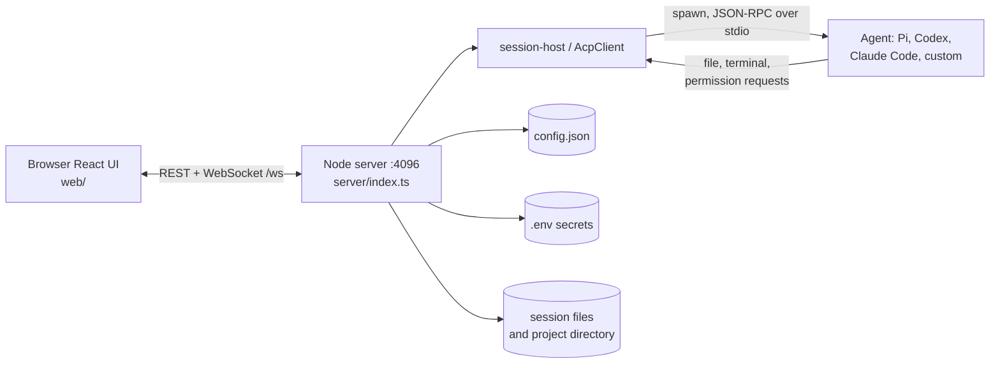
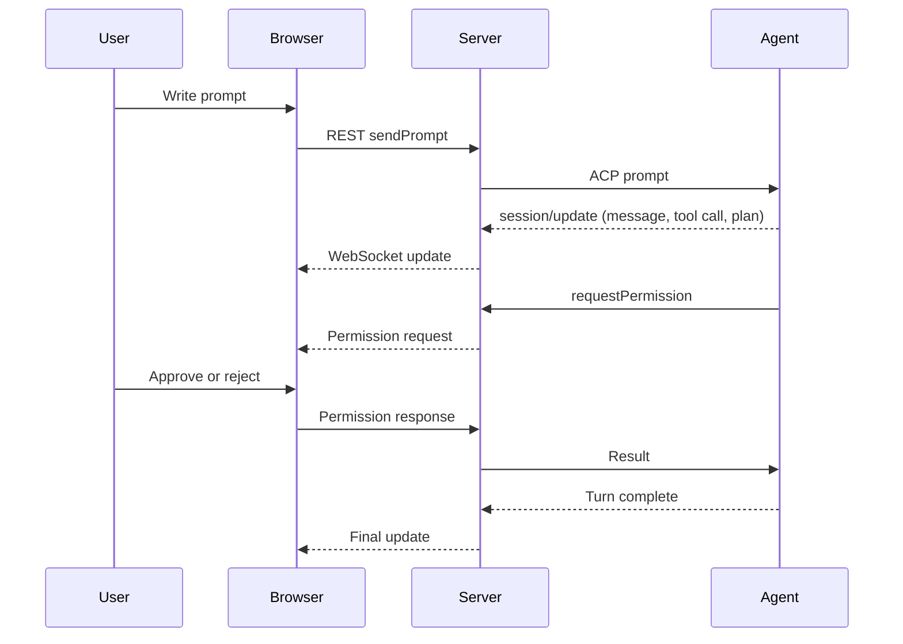

# trustant-acp

TruACP is the assistant runtime of [Trustant](https://github.com/trustant/trustant): a standalone [Agent Client Protocol](https://agentclientprotocol.com) (ACP) client made of a local Node server and a browser React UI. It launches coding agents (Pi, Codex, Claude Code, or a custom ACP agent) as subprocesses, streams their updates to the browser, and works on an application checkout in the Trustant workbench.

[SPEC.md](SPEC.md) is the source of truth for behavior. [ARCHITECTURE.md](ARCHITECTURE.md) describes the code layout, and [setup.md](setup.md) describes the installer.

## How it works



The server owns everything that needs Node (spawning agents, files, configuration, secrets). The browser only renders. Every agent event arrives through one `session/update` channel, which the server forwards over the WebSocket.



## Requirements

- Node.js and npm.
- For Trustant development, run it inside the `trudev` VM that Trustant's `start.sh` or `start.ps1` creates; `run.sh` refuses to start elsewhere and explains why.
- Agent credentials are read from `.env` (copy [.env.example](.env.example)): `ANTHROPIC_API_KEY`, `OPENAI_API_KEY`, `PI_API_KEY`. `config.json` refers to them by name; values are never stored in it.

Claude Code is not shipped. TruACP installs it on demand after the user accepts Anthropic's terms.

## Install and run

```bash
./setup.sh        # installs dependencies and the pinned agents (see setup.md)
npm run dev       # development: esbuild watcher + tsx watch, via run.sh
```

`npm run dev` serves `$WORKBENCH_DIR/trureact` on port 4096 by default. Override with:

```bash
ACP_DIR=/path/to/app ACP_PORT=4097 ACP_ENV=/path/to/.env npm run dev
```

Secrets are read from `$WORKBENCH_DIR/.env` before the server changes into the target directory. The app's own `.env` is never read, so an app cannot shadow provider credentials. Variables already exported take precedence over the file.

Without the VM assumptions, use the plain server:

```bash
npm run build:web
npm run serve -- --dir /path/to/app --port 4096
```

Server flags: `--dir` (project directory), `--port` (default 4096), `--config` (default `config.json`), `--env` (secrets file). `npm run acp -- --cli --agent pi "hello"` runs a one-shot prompt without the UI.

## Scripts

| Script | Purpose |
|---|---|
| `npm run dev` | Development stack through `run.sh` |
| `npm run serve` | Start the server (`tsx server/index.ts`) |
| `npm run build` | Build the web bundle and the server |
| `npm test` | Unit tests (Vitest) |
| `npm run lint`, `npm run format:check` | Biome lint and Prettier checks |

`npm run dev:plugin` builds the legacy Obsidian plugin from `src/main.ts` using `esbuild.config.mjs`. Obsidian supplies its API and CodeMirror at runtime.
For legacy source type information and Obsidian-specific lint, run `npm ci --prefix obsidian-legacy` and `npm run --prefix obsidian-legacy lint` from `acp/`. The standalone web and server builds use the standard `acp/` installation.
The optional Obsidian linter supports Node.js 20.19 and later in the 20.x series, 22.13 and later in the 22.x series, and Node.js 24 or later.

## Agents

| Agent | Package or command | Credential variable |
|---|---|---|
| Pi (default) | `pi-acp` | `PI_API_KEY` |
| Codex | `@agentclientprotocol/codex-acp` | `OPENAI_API_KEY` |
| Claude Code | `claude-agent-acp`, installed on demand | `ANTHROPIC_API_KEY` |
| Custom | Any ACP-compatible command in `customAgents` | Configurable |

Pinned versions live in [pi.version](pi.version) and are verified against [pi.integrity](pi.integrity). The managed Trustant extension in [extensions/](extensions/) adds stream protection for Pi.

## Contributing and security

TruACP is part of the Trustant repository. Read the root [AGENTS.md](../AGENTS.md), [acp/AGENTS.md](AGENTS.md), and [CONTRIBUTING.md](../CONTRIBUTING.md); a Contributor License Agreement is required. Report vulnerabilities privately as described in [SECURITY.md](../SECURITY.md).

Licensed under AGPL-3.0-or-later; see [LICENSE](LICENSE) and [NOTICE](NOTICE).
