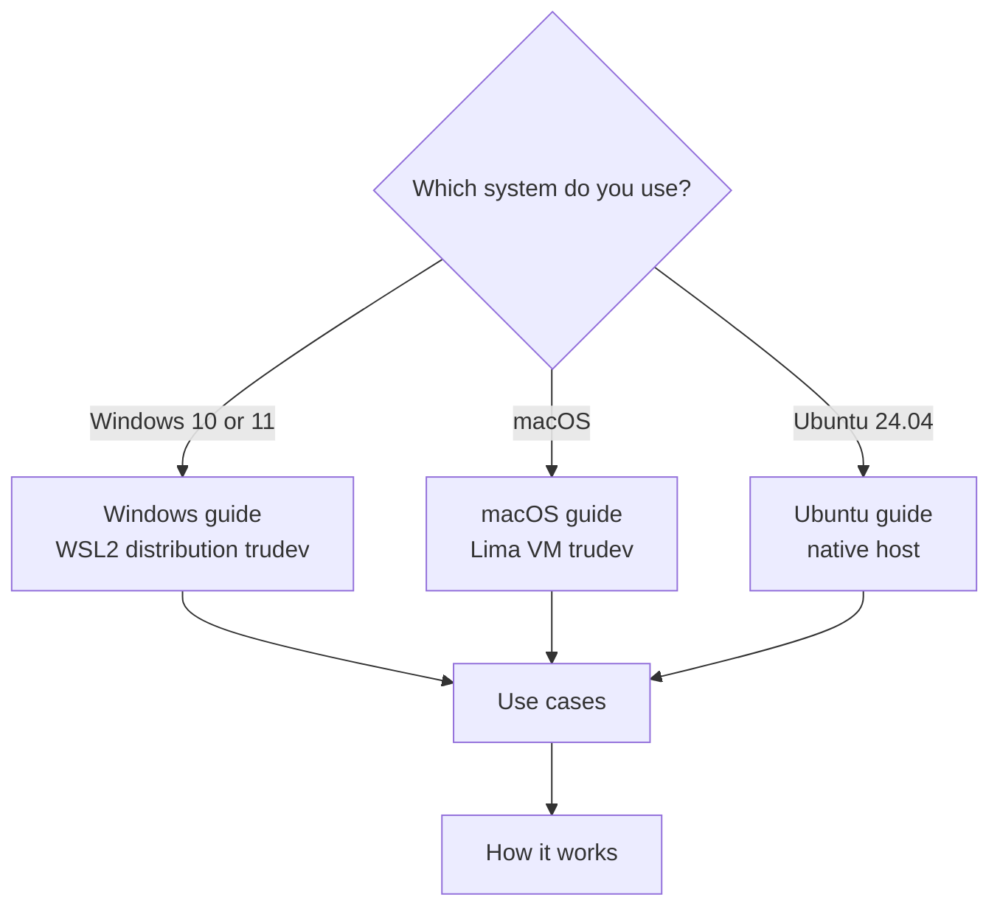

# Trustant guides

Practical guides for using Trustant. The [README](../README.md) is the short overview; the files under [spec/](../spec/) describe the intended behavior in detail.

## Choose your system

| System | Guide | Runs Trustant in |
|---|---|---|
| Windows | [Setup on Windows](setup-windows.md) | A WSL2 Ubuntu 24.04 distribution created by `start.ps1` |
| macOS | [Setup on macOS](setup-macos.md) | A Lima VM created by `start.sh` |
| Ubuntu | [Setup on Ubuntu](setup-ubuntu.md) | The machine itself, with k3s installed on the host |

## Then

- [How it works](how-it-works.md): components, hostnames, data layout, a chat turn, providers, publishing and authentication, with diagrams.
- [Ollama and Trustant](ollama.md): using an Ollama outside the environment, what the two need from each other, and more time for slow computers.
- [Use cases](use-cases.md): first run, creating and building an application, a local model with Ollama, backend services, shared secrets, publishing, restricting access, updating.

## Conventions

- The diagrams are Mermaid and render on GitHub.
- Commands are for the system named in the guide. On Windows and macOS, `setup.sh` and `run.sh` run inside the environment, not on the host.
- The guides describe the repository's scripts and specifications. Provisioning and model inference still depend on your network, hardware and chosen providers, so verify on your own machine.
