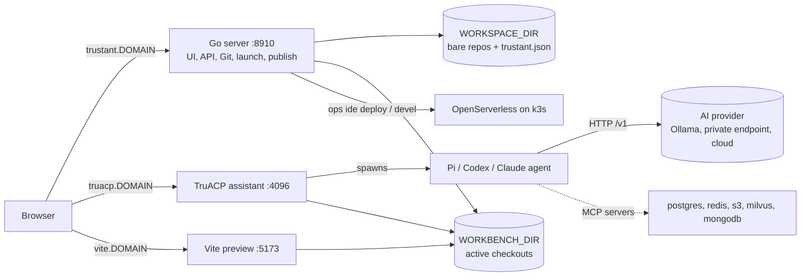
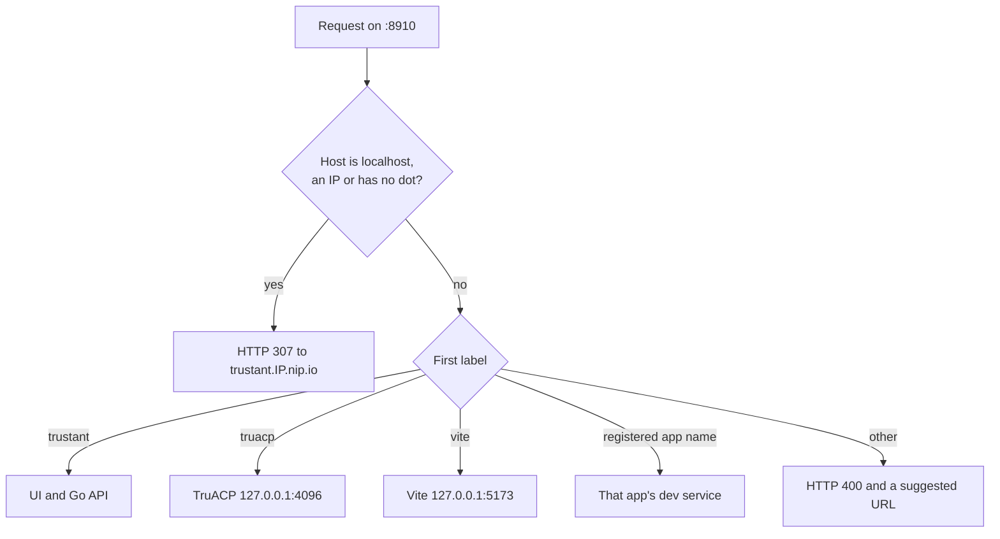
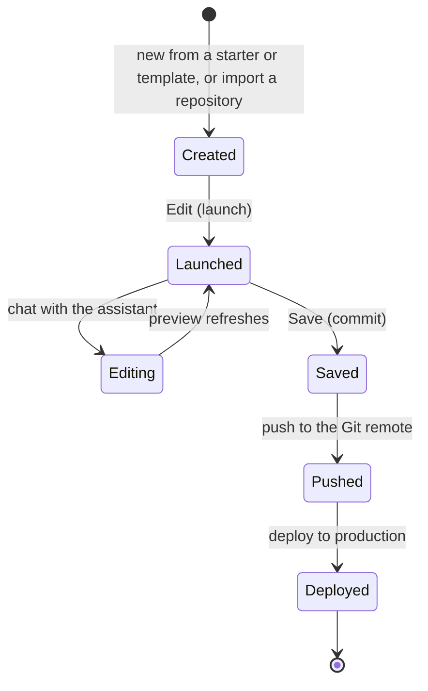
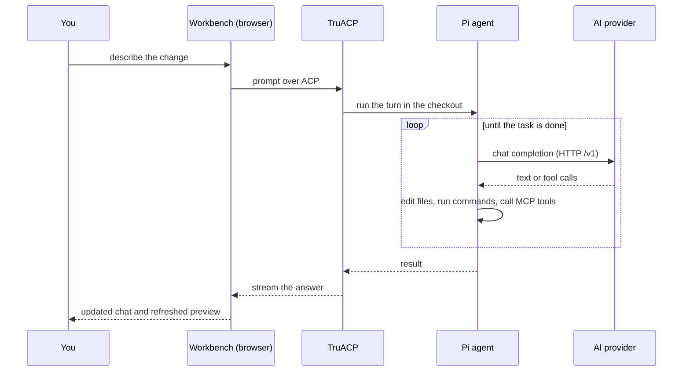
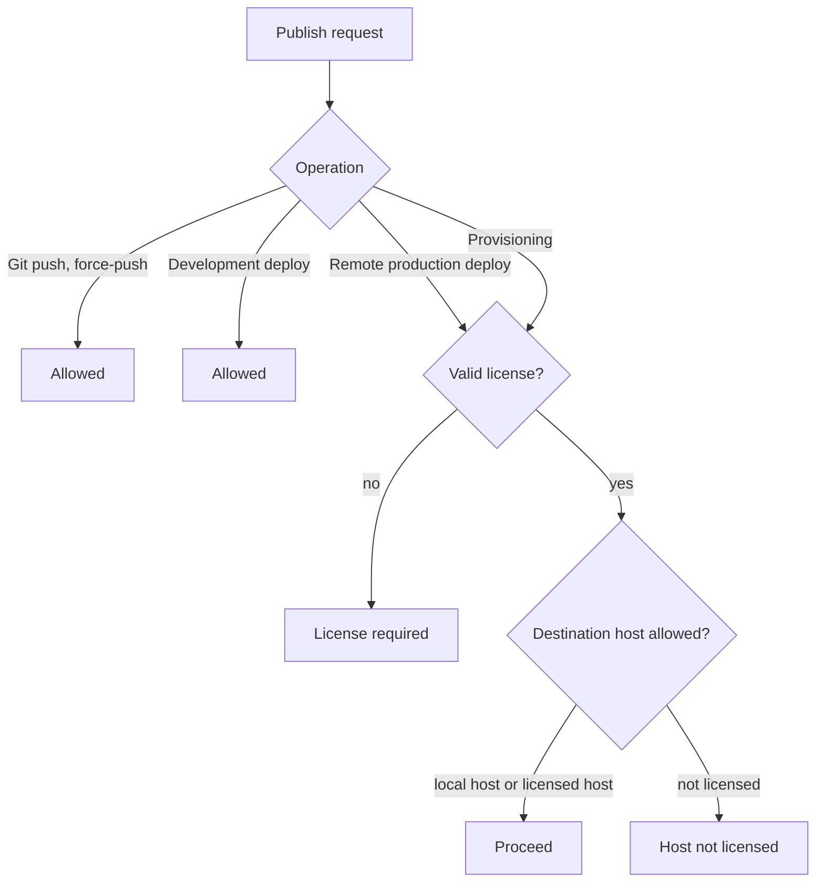

# How Trustant works

Trustant is a development environment for creating, running and publishing web applications backed by OpenServerless. You use it from a browser; an AI assistant edits the application source, a live preview shows the result, and Git keeps every change.

This guide explains the moving parts. For installation on your system see the [setup guides](README.md#choose-your-system); for what to do with it see [use cases](use-cases.md).

## The pieces

| Piece | Role | Where |
|---|---|---|
| Go server | Serves the UI and API, owns configuration, repositories, launch and publishing | `main.go`, feature files at the repository root |
| Web UI | Pages for the app list, the application workbench and configuration | `web/` |
| TruACP | Assistant host that talks to the coding agent (Pi by default) over ACP | `acp/` |
| Pi | The coding agent: reads and edits the checkout, runs tools and MCP servers | installed by `setup.sh`, pinned in `acp/pi.version` |
| Vite | Live preview of the application | started per application |
| OpenServerless on k3s | The local serverless cluster that applications deploy to | installed by `start.sh` |
| Ollama | Optional local model server | `localhost:11434` by default |

## Hostnames and ports

One listener, `:8910`, serves several hostnames and dispatches on the first label. Use the URL that the development loop prints; it uses a `nip.io` name so no DNS setup is needed.

Details and the authentication boundary: [spec/authentication.md](../spec/authentication.md).

## Where your work lives

Each application has two directories:

- `WORKSPACE_DIR/workspace/<name>/` is the durable **bare Git repository**.
- `WORKBENCH_DIR/<name>/` is the **active checkout** that the assistant edits and the preview serves.

Launch restores a missing checkout and regenerates managed configuration, such as environment files. Save your work with the Git controls of the application page, so it reaches the repository and, if configured, its remote. Keep credentials out of source repositories.

## Life of an application

Launching an application restores the checkout, resolves its environment variables, starts the preview and opens the workbench with the assistant, preview, file viewer and terminal. See [launch lifecycle](../spec/4-launch.md).

## How a chat turn works

The model provider is chosen on first run and can be changed on the configuration page. The agent needs a model that supports tool calls and a context window large enough for its instructions and tools.

## AI providers

| Provider card | Stored as | Use it when |
|---|---|---|
| Cloud AI | `ollama` | You have an Ollama Cloud account; Trustant uses the internal Ollama server with the recommended cloud models |
| Trustant Cloud | `trustant` | You sign up for the hosted service and its credits |
| Private AI | `private` | You run your own OpenAI-compatible endpoint, including an Ollama on your machine or network; the URL must end in `/v1` |

Details: [configuration](../spec/2a-config.md) and [provider choice](../spec/1-index.md). For running Ollama on your own computer, see the "Ollama on your computer" section of your OS guide.

## Services for generated applications

Every application gets its own OpenServerless user. The services it can use (PostgreSQL, Redis, S3, Milvus, MongoDB) are exposed to the assistant through MCP servers only when the service is enabled for that user. Generated applications use wrappers generated by the assistant, not the MCP servers, at runtime.

Applications can share selected secrets: one app **exports** stable names, another **imports** them. See [shared secrets](../spec/18-shared.md) and [importing variables](../spec/19-import.md).

## Publishing

With license enforcement on (the default), pushing to Git and deploying to the local development cluster need no license; remote production deployment and provisioning do. See [publishing](../spec/6-publish.md) and [license behavior](../spec/14-license.md).

## Authentication

Local administrator authentication is optional and off by default, so a fresh checkout opens without a login. While it is off, port `8910` is served over plain HTTP to every host that can reach it, including the terminal, file and deploy APIs; keep it on a trusted network. To require a login, set `TRUSTANT_AUTH_MODE=local` with your own credentials as described in [spec/authentication.md](../spec/authentication.md). The preview and assistant hostnames are not covered by that login.
