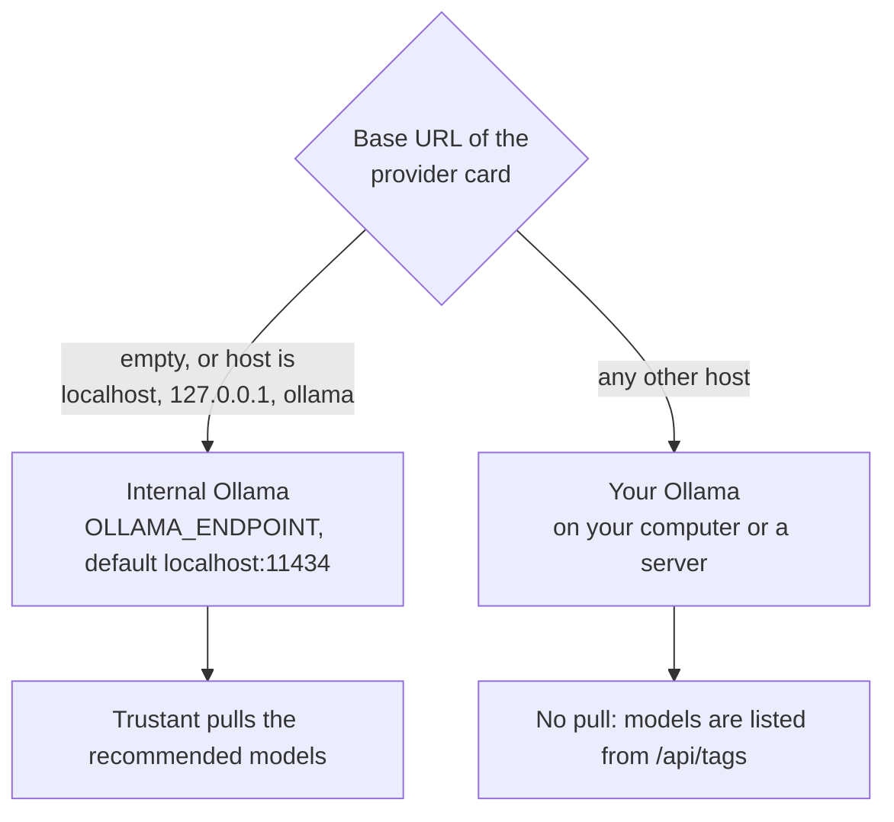

# Ollama and Trustant

How Trustant talks to Ollama, how to use an Ollama that runs **outside** the Trustant environment (on your computer or on a server), what to expect from the context window, and how to give a slow computer more time.

## Which Ollama Trustant uses



- **Internal Ollama** is the one `start.sh` / `start.ps1` installs inside the environment (the WSL2 distribution, the Lima VM, or the Ubuntu host). Trustant pulls the models it recommends.
- **Your own Ollama** is any other host. Trustant never pulls models there: it lists what is installed through `GET <host>/api/tags` and only tests the connection.

## Use an Ollama outside the environment

Use this when the model runs on your computer (for example with a GPU and models you already have) while Trustant runs in WSL2 or a VM, or when it runs on another server.

1. **Make it reachable.** On the machine that runs Ollama set `OLLAMA_HOST=0.0.0.0:11434` (listen on the network) and a large context, `OLLAMA_CONTEXT_LENGTH=32768`. Restart Ollama so the variables apply.
2. **Open the port.** Allow inbound TCP 11434 from the Trustant environment (firewall, security group).
3. **Check from the Trustant environment**, not from the machine itself: `curl http://<address>:11434/api/tags` must list your models.
4. **Point Trustant at it.** Either keep the **Cloud AI** provider and, on the Configure page, turn on **Use an external Ollama** in the **Ollama Instance** card (add the server once as a named instance and switch between several, for example different clusters; the choice is saved and turning it off returns to the Ollama of this machine, which stays the default). Or, in the UI choose **Private AI**, enter `http://<address>:11434/v1` (the `/v1` suffix is required) and leave the key empty. Pick the chat model from the list or type it.
5. **Never use `localhost` for it** from inside WSL2 or a VM: there it is the environment's own Ollama. On Windows, WSL's localhost forwarding can even map `127.0.0.1:11434` to the distribution's Ollama.

Per system details: [Windows](setup-windows.md#ollama-on-your-computer), [macOS](setup-macos.md#ollama-on-your-computer), [Ubuntu](setup-ubuntu.md#ollama-on-your-computer).

### Traps seen in practice

| Symptom | Cause | Fix |
|---|---|---|
| `model '<name>' not found` although the model is on disk | An Ollama that was already running (for example started by the tray application) serves a different model folder, so `/api/tags` returns `{"models":[]}` | Quit that Ollama completely, then start `ollama serve` with `OLLAMA_MODELS` set to the folder that holds the models |
| `the prompt is longer than the context length` (HTTP 400) | The context fell back to the default (4096 on a small GPU) after a restart | Set `OLLAMA_CONTEXT_LENGTH` (32768 or more) in the **user** environment so every start picks it up |
| Chat stays silent for a minute, then answers | The model was not loaded yet, or a thinking model is working | Wait; see [slow computers](#slow-computers) |
| Works, then stops after a reboot | The host address changed (DHCP, WSL2 NAT) | Use a fixed address or a name, and update the base URL |
| Probe from the environment times out | Firewall blocks 11434 | Allow inbound TCP 11434 for the Trustant network |

## What Trustant and Ollama need from each other

| Topic | Detail |
|---|---|
| Protocol | OpenAI-compatible API under `/v1` (`/v1/models`, `/v1/chat/completions`); `/api/tags` and `/api/pull` for Ollama specifics |
| Connection test | Trustant asks the configured Pi model to "Reply with exactly: OK" and requires the answer to contain "ok" |
| Context window | The assistant sends long prompts (tools, project instructions). With 4096 tokens it fails with HTTP 400; 32768 is a safe starting point and can be raised as memory allows |
| Model size | Pi works best with models of about 20B parameters or more. A smaller model is used when you choose it, with a warning in the log |
| Chat model list | Embedding and reranking models (for example `bge-m3`, `nomic-embed-text`) are not offered for the chat model; they stay usable for RAG |
| Models | An external Ollama is never pulled to: install the models there yourself |
| First answer | A cold model must load into memory first, and models that think before answering can take a minute or more on modest hardware |

## Slow computers

Waits that depend on the speed of the machine have generous defaults, so a slow PC is not reported as broken:

| Wait | Default |
|---|---|
| Connection test of the model (`Reply with exactly: OK`) | 180 s |
| Ollama reachability check on the provider card | 12 attempts, each waits up to 15 s |
| Listing the installed models (`/api/tags`) | 30 s |
| Model suggestions in the variables dialog | 8 s |
| Dev server and agent ports after a launch (4096 and 5173) | 120 s each |
| Dev server after a redeploy | 120 s |
| Previous dev server to release its port | 30 s |
| Pulling one model (internal Ollama only) | 600 s |

To stretch all of them except the model pull, set `TRUSTANT_TIMEOUT_FACTOR` in `.env` (or the environment of the server). `2` doubles every wait, `1` keeps the defaults, values above `10` are capped at `10`, and an invalid value counts as `1`.

```bash
TRUSTANT_TIMEOUT_FACTOR=2
```

The first message after a model has been idle can still be slow, because Ollama unloads idle models. `OLLAMA_KEEP_ALIVE` (for example `30m`) keeps a model in memory longer.
