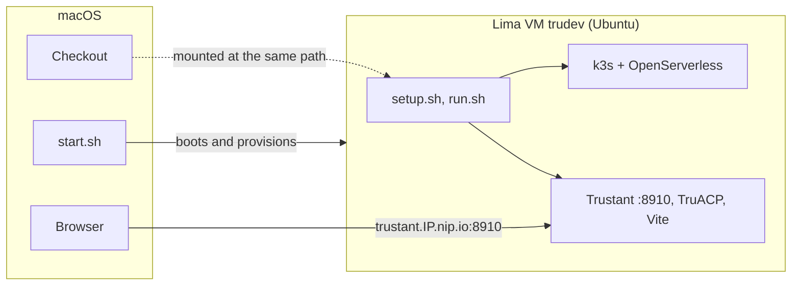
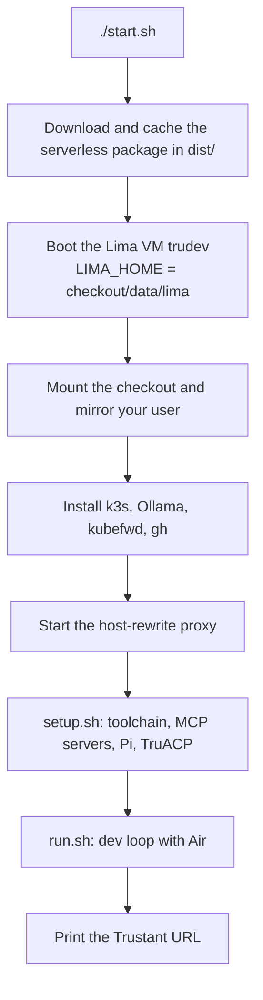

# Trustant on macOS (Lima)

On macOS, Trustant runs inside a Lima Ubuntu virtual machine named `trudev`. Your checkout is mounted into the VM, and you use the UI from your macOS browser.



## Requirements

- macOS with [Homebrew](https://brew.sh), Git and Lima.
- At least 8 GB of memory, 4 CPUs and 50 GB of free disk. The VM is configured with 8 GiB of memory and a 60 GiB disk; leave room for the checkout and the download cache.
- A checkout path that is not too long: macOS limits unix socket paths to 103 bytes and Lima keeps sockets inside the checkout. `start.sh` stops early with "checkout path too long" if the path is over the limit.
- Network access: the first start downloads the serverless package (about 3 GB) and an Ollama build (about 1.5 GB).
- `miniops.me` must resolve to `127.0.0.1`; if your router blocks it, use public DNS or add an exception.

## First setup

```bash
brew install lima
git clone https://github.com/trustant/trustant.git
cd trustant
./start.sh
```

The `install` script at the repository root can also clone and pre-download the large artifacts without starting anything (see [spec/install.md](../spec/install.md)).

### What the first start does



The VM lives in `data/lima/trudev/` inside the checkout (the folder is Git-ignored). A VM left by an older script in `~/.lima/trudev` is ignored, not migrated. Re-running `./start.sh` with an existing VM reuses it.

## Open the UI

When the loop is ready it prints a URL like `http://trustant.<ip>.nip.io:8910/`. Open it in your browser, then follow the [first-run steps](use-cases.md#1-first-run-choose-a-provider).

## Everyday commands

| Task | Command |
|---|---|
| Start the VM and the dev loop | `./start.sh` |
| Provision only, do not start the loop | `./start.sh -n` |
| Open VS Code attached to the VM | `./start.sh -v` |
| Restart only the dev loop | `./ssh.sh ./run.sh` |
| Open a development shell in the VM | `./ssh.sh -d` |
| Stop the VM (keeps everything) | `./start.sh -s` |
| Destroy the VM and its disk | `./start.sh -k` |

`ssh.sh` also has modes for the installed Trustant user and the deployed container; see [spec/start.md](../spec/start.md#sshsh-has-three-access-modes). `-k` discards the VM and everything inside it; your checkout stays.

## Ollama on your computer

The start script installs a CPU-only Ollama **inside the VM** at `localhost:11434`; the Cloud AI card uses it. If you prefer the Ollama app on your Mac, which can use Apple silicon acceleration and your existing models, point the **Private AI** card at it. This path is not covered by the repository's automated checks, so verify each step on your machine.

1. Make the Mac's Ollama listen on all interfaces and give it a larger context, then restart it:

   ```bash
   launchctl setenv OLLAMA_HOST "0.0.0.0:11434"
   launchctl setenv OLLAMA_CONTEXT_LENGTH "32768"
   ```

   Quit and reopen the Ollama app. A small default context makes the assistant fail with `the prompt is longer than the context length`.

2. Lima exposes the Mac to the VM as `host.lima.internal`. Check from the VM (`./ssh.sh -d`):

   ```bash
   curl http://host.lima.internal:11434/api/tags
   ```

3. In the UI choose **Private AI** and enter `http://host.lima.internal:11434/v1` (the `/v1` suffix is required); leave the key empty.

Do not use `localhost:11434` for this: inside the VM it is the VM's own Ollama.

## Troubleshooting

| Symptom | Check |
|---|---|
| "checkout path too long" | Move the checkout to a shorter path |
| `limactl` not found | `brew install lima` |
| VM does not boot or is slow | Free memory and disk; destroy and recreate with `./start.sh -k` then `./start.sh` |
| Browser shows HTTP 400 or redirects | Use the printed `trustant.<ip>.nip.io` URL |
| Chat never answers | Provider endpoint unreachable or context too small (see the Ollama section) |
| The package download fails | The version is hard-pinned in `truserverless.txt`; check network access |

Full details: [spec/start.md](../spec/start.md#macos-lima-vm), [development loop](../spec/run.md) and the [README](../README.md#limits-and-troubleshooting).
