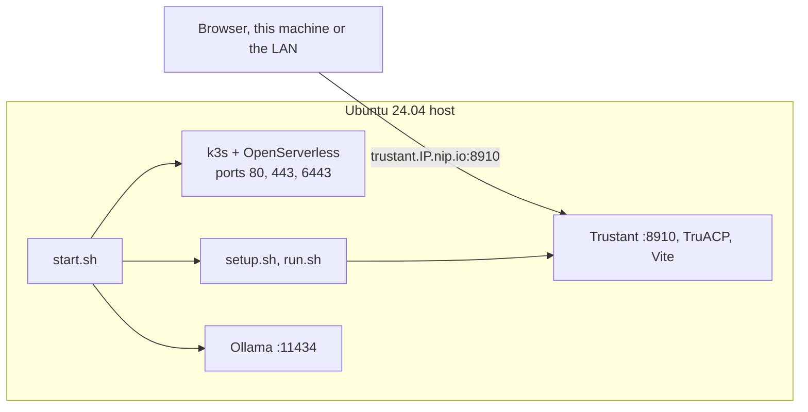
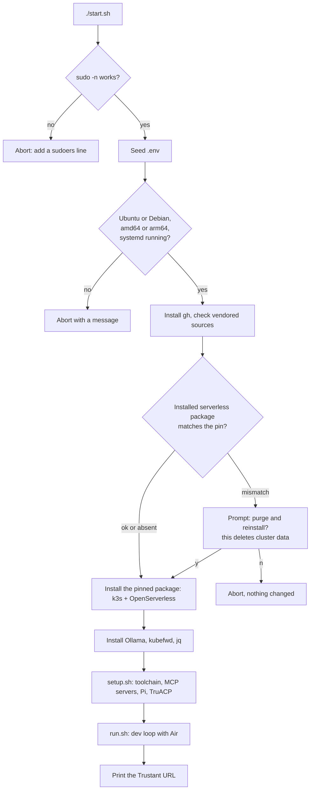

# Trustant on Ubuntu

On Ubuntu, there is no VM: `./start.sh` prepares this machine directly and installs the local serverless cluster (k3s) on it. Use a development machine, not a shared server.



## Requirements

- Ubuntu 24.04 on amd64 or arm64, with systemd running.
- A user with passwordless `sudo` (`sudo -n true` must succeed). Provisioning installs packages and runs `kubefwd` as root.
- At least 8 GB of memory, 4 CPUs and 50 GB of free disk.
- **Ports 80 and 443 free.** k3s listens on them; stop other web servers first (for example `sudo systemctl stop nginx`). The check is skipped when Trustant's own k3s is already running.
- `apt-get`, `git` and network access: the first start downloads the serverless package (about 3 GB) and an Ollama build (about 1.5 GB).
- `miniops.me` must resolve to `127.0.0.1`; if your router blocks it, use public DNS or add an exception.

## First setup

```bash
git clone https://github.com/trustant/trustant.git
cd trustant
./start.sh
```

The `install` script at the repository root can also clone and pre-download the large artifacts without starting anything (see [spec/install.md](../spec/install.md)).

### What the first start does



Read the purge prompt carefully: it removes `/var/lib/rancher/k3s`, `/home/trustant` and the `trustant` account. Without a terminal the script fails and prints the command instead of purging.

## Open the UI

The loop prints a URL like `http://trustant.<ip>.nip.io:8910/`. On a native host the address is the LAN address, so the URL also works from another machine, which means port 8910 is reachable by others on the network. Authentication is off by default (see [how it works](how-it-works.md#authentication)); keep the host on a trusted network or enable local authentication. Then follow the [first-run steps](use-cases.md#1-first-run-choose-a-provider).

## Everyday commands

| Task | Command |
|---|---|
| Prepare the host and start the dev loop | `./start.sh` |
| Provision only, do not start the loop | `./start.sh -n` |
| Restart only the dev loop | `./run.sh` |
| Update setup and pinned tools after `git pull` | `./setup.sh`, then `./run.sh` |

Press Ctrl+C to stop the loop. `run.sh` frees ports 8910, 5173 and 4096 before it starts. There is no VM to stop or destroy: `./start.sh -s` and `-k` are refused on a native host.

## Ollama on your computer

`start.sh` installs a CPU-only Ollama at `localhost:11434`, pinned to the version in `image/Dockerfile`, and the Cloud AI card uses it. The `OLLAMA_ENDPOINT` in `.env` points there, and `run.sh` starts `ollama serve` only when `OLLAMA_ENDPOINT` is a local address and nothing listens on the port.

To use a different Ollama, for example one with a GPU on another machine:

1. On that machine, make Ollama listen on the network and give it a larger context (for a systemd service, add `Environment="OLLAMA_HOST=0.0.0.0:11434"` and `Environment="OLLAMA_CONTEXT_LENGTH=32768"` with `sudo systemctl edit ollama`, then restart it). A small default context makes the assistant fail with `the prompt is longer than the context length`.
2. Check from the Trustant host: `curl http://<host>:11434/api/tags`.
3. In the UI choose **Private AI** and enter `http://<host>:11434/v1` (the `/v1` suffix is required); leave the key empty.

## Troubleshooting

| Symptom | Check |
|---|---|
| Abort about sudo | Add a passwordless sudoers line for your user |
| Abort about ports 80 or 443 | Stop the service listening there (`sudo ss -ltnp`) |
| Abort about systemd | Not supported in a container or a systemd-less environment |
| Prompt to purge the package | The installed version differs from the pin; read the warning before answering |
| Browser shows HTTP 400 or redirects | Use the printed `trustant.<ip>.nip.io` URL |
| Chat never answers | Provider endpoint unreachable or context too small (see the Ollama section) |

Full details: [spec/start.md](../spec/start.md#native-ubuntu-linux), [development loop](../spec/run.md) and the [README](../README.md#limits-and-troubleshooting).
