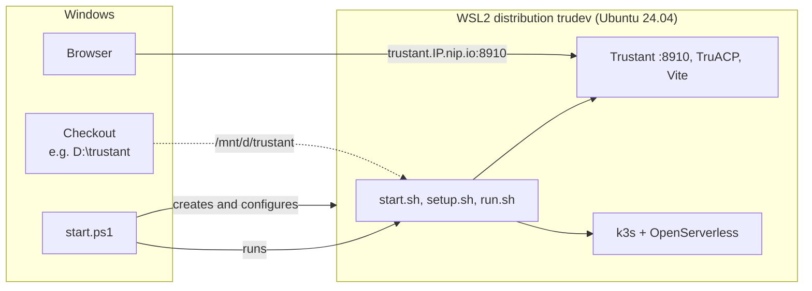
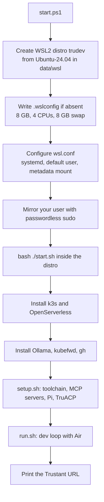

# Trustant on Windows (WSL2)

On Windows, Trustant runs inside a dedicated WSL2 Ubuntu distribution named `trudev`. The source stays in your Windows checkout; the distribution reaches it through the WSL mount, and you use the UI from your Windows browser.



## Requirements

- Windows 10 or 11 with WSL2 (check with `wsl --version`; run `wsl --update` if it is old).
- Git. If it is missing, the `install` script offers to install it with `winget`.
- At least 8 GB of memory, 4 CPUs and 50 GB of free disk on the drive of the checkout.
- A checkout path made of a drive letter and **no spaces** (for example `D:\trustant`). The folder is used from WSL as `/mnt/<drive>/...` and a space breaks the scripts.
- Network access: the first start downloads the serverless package (about 3 GB) and an Ollama build (about 1.5 GB).
- `miniops.me` must resolve to `127.0.0.1`. Some routers block this name; if so, use public DNS (for example 8.8.8.8 and 1.1.1.1) or add an exception on the router.

## First setup

```powershell
git clone https://github.com/trustant/trustant.git
cd trustant
.\start.ps1
```

If PowerShell refuses to run the script, run it once with a bypass, or relax the policy for your user:

```powershell
powershell -ExecutionPolicy Bypass -File .\start.ps1
Set-ExecutionPolicy -Scope CurrentUser -ExecutionPolicy Bypass
```

Optionally, the `install` script at the repository root clones the repository and pre-downloads the large artifacts without starting anything (see [spec/install.md](../spec/install.md)).

### What the first start does



`start.ps1` writes `%USERPROFILE%\.wslconfig` only when it does not exist; an existing file is left alone. The first start takes a long time; later starts reuse everything.

## Open the UI

When the loop is ready it prints a URL like `http://trustant.<ip>.nip.io:8910/`. Open it in your browser, then follow the [first-run steps](use-cases.md#1-first-run-choose-a-provider). Use the printed hostname: `localhost` and bare IP addresses are redirected to it.

### Test an app from another LAN device

Launch the app with **Edit**. In WSL2 NAT mode, the IP on the printed URL belongs to WSL. Use the Windows host's LAN IP from another device. Forward TCP port `8080` on the Windows LAN address to port `8080` on the current WSL address, and scope the Windows firewall rule to the private LAN. Leave the Trustant editor port `8910` outside that forwarding rule.

The proxy routes by hostname. Point `<app>.miniops.me` at the Windows LAN IP in your LAN DNS or the client device's hosts file, then open `http://<app>.miniops.me:8080/`. To test before changing DNS, substitute your app name and Windows LAN IP in this command on the client:

```sh
curl --resolve '<app>.miniops.me:8080:<windows-lan-ip>' 'http://<app>.miniops.me:8080/'
```

Update the port forward if WSL gets a new IP. See the [host-rewrite proxy](../spec/start.md#host-rewrite-reverse-proxy-in-k3s).

## Everyday commands

| Task | Command |
|---|---|
| Start the environment and the dev loop | `.\start.ps1` |
| Provision only, do not start the loop | `.\start.ps1 -n` |
| Open VS Code attached to the distribution | `.\start.ps1 -v` |
| Stop the distribution (keeps everything) | `.\start.ps1 -s` |
| Remove the distribution and its Linux filesystem | `.\start.ps1 -k` (asks you to type the name) |
| Use another distribution name | `-Distro <name>` (default `trudev`) |

To restart only the dev loop inside the distribution, run `./run.sh` from the checkout there. Press Ctrl+C to stop it. `-k` never touches your Windows checkout.

## Ollama on your computer

The start script installs a CPU-only Ollama **inside the distribution** at `localhost:11434`; the Cloud AI card uses it. If you prefer the Ollama you installed on Windows (it can use your GPU and your existing models), point the **Private AI** card at it:

1. On Windows, make Ollama listen on all interfaces and give it a context window large enough for the agent. Set user environment variables, then quit and restart Ollama:

   ```powershell
   [Environment]::SetEnvironmentVariable('OLLAMA_HOST', '0.0.0.0:11434', 'User')
   [Environment]::SetEnvironmentVariable('OLLAMA_CONTEXT_LENGTH', '32768', 'User')
   ```

   Without a larger context, Ollama may default to 4096 tokens on a small GPU, and the assistant fails with `the prompt is longer than the context length`. Raise it as far as your memory allows.

2. Find the address of the Windows host as seen from the distribution (WSL2 NAT mode):

   ```bash
   ip route show default | awk '{print $3}'
   ```

   Check that it answers: `curl http://<that-ip>:11434/api/tags`. If it times out, allow inbound TCP 11434 for the WSL network in Windows Firewall.

3. In the UI choose **Private AI** and enter `http://<that-ip>:11434/v1` (the `/v1` suffix is required); leave the key empty.

   With the **Cloud AI** provider you can instead use the **Ollama Instance** card on the Configure page: it detects the Windows host's Ollama by itself (the WSL default gateway, only when it answers `/api/tags`) and offers it with an **Add** button. Adding it saves a preset; you still turn on **Use an external Ollama** yourself.

4. Optional: to stop `start.sh` from installing and enabling the distribution's own Ollama (which would then answer on `localhost:11434`), run it with `OLLAMA_EXTERNAL=1` in its environment, for example `wsl -d <distro> -- env OLLAMA_EXTERNAL=1 bash ./start.sh`. The default is unchanged. If you start through `start.ps1`, check that the variable reaches `start.sh`: that path has not been verified.

Do not use `localhost:11434` for this: inside the distribution it is the distribution's own Ollama, and WSL's localhost forwarding can also map Windows `127.0.0.1:11434` to it. The host address can change after a reboot; repeat step 2 if the assistant stops responding.

## Troubleshooting

| Symptom | Check |
|---|---|
| `start.ps1` refuses to run | Execution policy (see above) |
| Error about `--name` or `--location` | Old `wsl.exe`: run `wsl --update` |
| `start.ps1` aborts on CRLF line endings, or scripts fail with `$'\r'` errors | The repository ships a `.gitattributes` that forces LF, but an older checkout or the `oplugins-truinst` submodule can still be CRLF. Follow the renormalization commands the script prints, or re-clone |
| Path error right at the start | The checkout path has a space or is not on a drive letter |
| Browser shows HTTP 400 or redirects | Use the printed `trustant.<ip>.nip.io` URL |
| Chat never answers | Provider endpoint unreachable or context too small (see the Ollama section) |
| Everything is slow | Raise memory and CPUs in `%USERPROFILE%\.wslconfig`, then `wsl --shutdown` |

Full details: [spec/start.md](../spec/start.md#windows-wsl2--startps1), [development loop](../spec/run.md) and the [README](../README.md#limits-and-troubleshooting).
