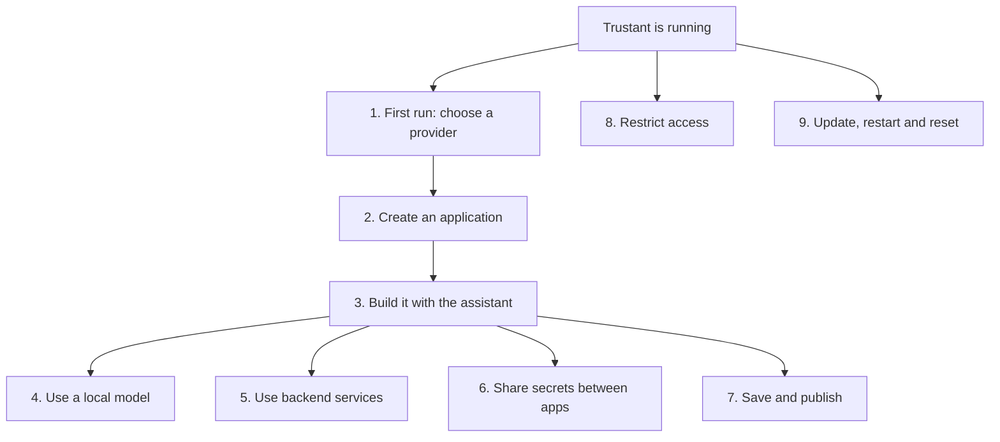
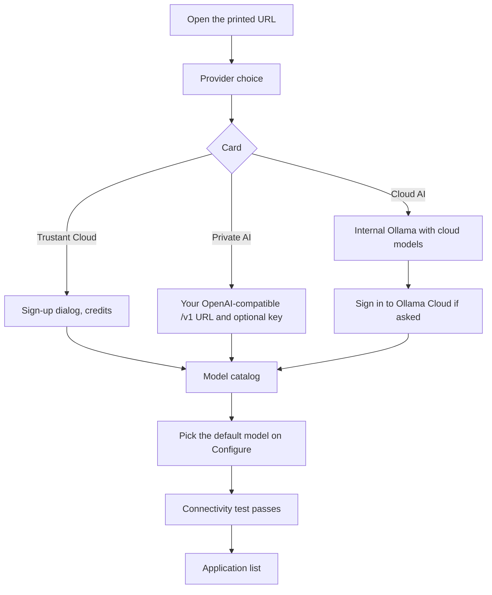
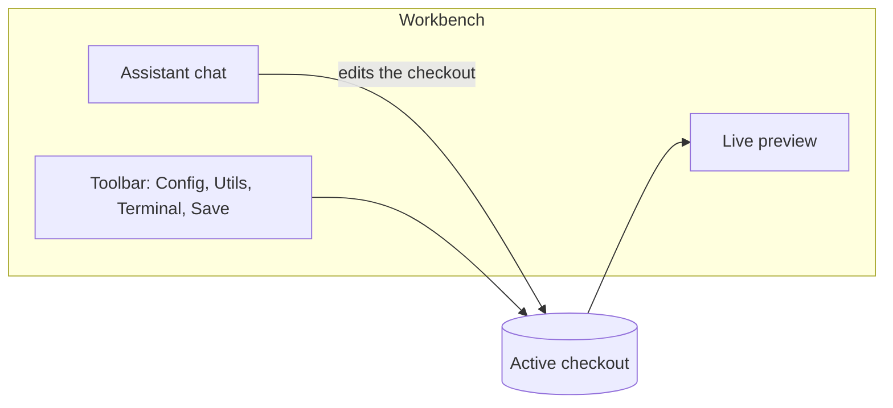
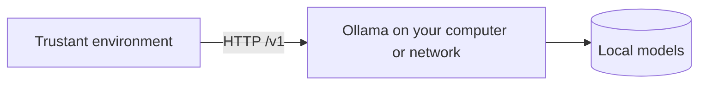
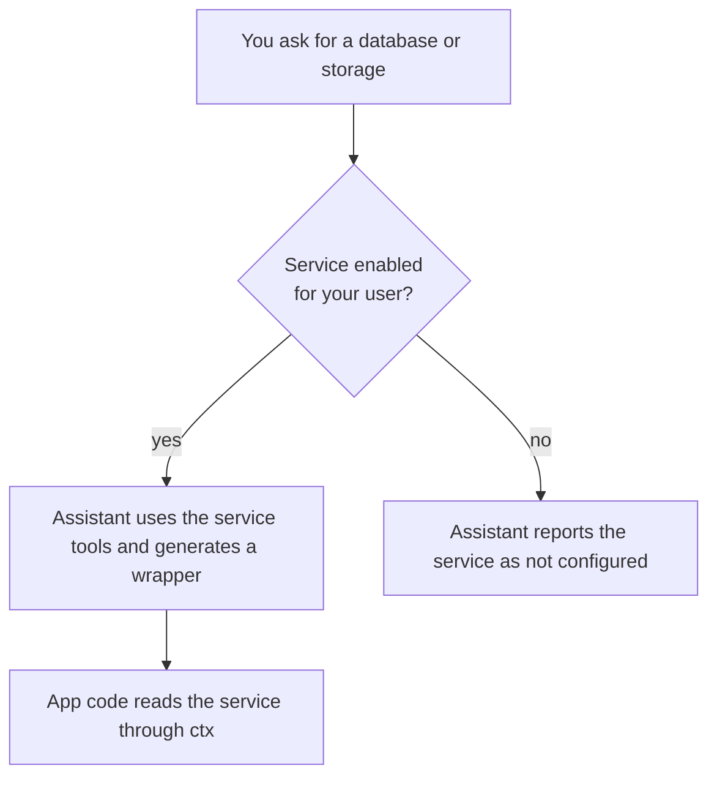
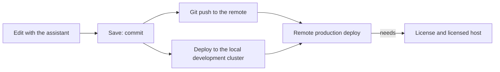

# Use cases

Task-oriented walkthroughs for a running Trustant. Each case names the screens involved and links to the behavior specification. Installation is covered by the setup guides for [Windows](setup-windows.md), [macOS](setup-macos.md) and [Ubuntu](setup-ubuntu.md); the architecture is in [how it works](how-it-works.md).

## 1. First run: choose a provider

The first time you open the UI, it asks which AI provider the assistant should use. Nothing else works until a provider and a model are set.

1. Open the URL printed by the development loop.
2. Pick a card: **Cloud AI** (Ollama Cloud through the internal Ollama; the UI shows a sign-in link if needed), **Trustant Cloud** (hosted service with credits), or **Private AI** (your own endpoint, such as an Ollama on your machine, see case 4).
3. Choose a model on the Configure page. Pick one that supports tool calls.
4. Wait for the connectivity check to pass; you land on the application list.

If the model catalog changes later, Trustant asks you to pick the model again. See [provider choice](../spec/1-index.md) and [configuration](../spec/2a-config.md).

## 2. Create an application

On the application list, press **Add App**. The dialog has two modes:

| Mode | Use it to |
|---|---|
| **New application** | Start from a minimal starter and build the features with the assistant. The list shows the published starters, and **My Application Starter** is always available |
| **From a template** | Copy a ready-made application from the catalog (grouped as Apps, Chat, Demo, Utilities and so on) and customize it |

Type a name (it follows the chosen starter until you edit it) and confirm. If the catalog cannot be loaded, the dialog still works with **My Application Starter**. See [applications list](../spec/1-applist.md) and [starters](../spec/15-starters.md).

## 3. Build it with the assistant

Press **Edit** on an application to launch it and open the workbench.

- Describe what you want in the chat; the assistant edits the files and the preview refreshes.
- **Terminal** opens a shell in the checkout; **Config** edits environment variables, skills and `AGENTS.md`; **Utils** has Revert, Reload, Redeploy, Clean, Debug, Files and Upload.
- **Tutorial** in the top bar starts guided walkthroughs of the templates, menus and toolbar.
- Use **Save** to commit your changes; **Revert** drops uncommitted ones.

See [application page](../spec/3-app.md) and [Pi runtime](../spec/trustant-pi-runtime.md).

## 4. Use a local model (Ollama)

Choose this when you want inference on your own hardware or network.

1. Run Ollama where the models are and make it reachable from the Trustant environment. Set a context window of at least 32768 tokens (`OLLAMA_CONTEXT_LENGTH`): with a small default the assistant fails with `the prompt is longer than the context length`.
2. On the provider screen choose **Private AI** and enter `http://<host>:11434/v1`. The `/v1` suffix is required; the key may stay empty.
3. Pick a model that supports tool calls. Small models often misread instructions; Trustant warns before you pick one.

The address to use depends on where Trustant runs: see "Ollama on your computer" in the [Windows](setup-windows.md#ollama-on-your-computer), [macOS](setup-macos.md#ollama-on-your-computer) or [Ubuntu](setup-ubuntu.md#ollama-on-your-computer) guide.

## 5. Use backend services

Applications can use PostgreSQL, Redis, S3, Milvus and MongoDB. A service is available to the assistant only when it is enabled for your OpenServerless user.

Ask for what you need in the chat; the assistant uses the matching `action-add-<service>` tool and writes the wrapper. It does not invent connection variables, and it will not ask you for infrastructure details. See [launch](../spec/4-launch.md) and [user provisioning](../spec/user_provisioning.md).

## 6. Share secrets between applications

An application can export selected secrets under stable names, and another can import them, so the second app never needs the first one's login.

1. In the producing app, declare the values in `.env.shared` (each name carries the app prefix) and export them from the Share dialog.
2. In the consuming app, declare what it needs in `.env.dist` and import it from the Import tab of the Share dialog.
3. Launch resolves every imported variable; credentials that rotate are refreshed from the pool.

See [shared secrets](../spec/18-shared.md) and [importing variables](../spec/19-import.md).

## 7. Save and publish

| Action | License |
|---|---|
| Save, Git push, force-push | not required |
| Development deploy | not required |
| Remote production deploy | valid license and destination host |
| Provisioning an app on a host | valid license |

Set the production environment values on the application's configuration before deploying, and install a license on Configure when you publish remotely. Errors beginning with `License required` or `Host not licensed` open the license dialog. See [publishing](../spec/6-publish.md), [license](../spec/14-license.md) and [Git](../spec/5-git.md).

## 8. Restrict access

A fresh install has no login and serves plain HTTP on port `8910`, which exposes the terminal, files and deploy APIs to everyone who can reach the machine. On a shared or reachable network:

- Keep the host on a trusted network or behind a firewall, and
- Enable local administrator authentication with your own credentials by setting `TRUSTANT_AUTH_MODE=local` together with the username, password hash and session key variables described in [spec/authentication.md](../spec/authentication.md).

Credentials belong in an operator-managed secret or process environment, never in the repository or an application's `.env`. The assistant, preview and application hostnames are outside this login.

## 9. Update, restart and reset

| Goal | Do this |
|---|---|
| Restart the dev loop | `./run.sh` inside Ubuntu (macOS: `./ssh.sh ./run.sh`), Ctrl+C to stop |
| Update after a `git pull` | `git pull --ff-only --recurse-submodules`, `git submodule update --init --recursive`, `./setup.sh`, `./run.sh` |
| Stop the environment | `./start.sh -s` (macOS) or `.\start.ps1 -s` (Windows) |
| Discard the environment | `./start.sh -k` or `.\start.ps1 -k`: removes the VM or distribution, not your checkout |

Review local changes with `git status --short` before updating. On Windows and macOS, run `setup.sh` and `run.sh` inside the environment (the shell commands are printed by `start.ps1`, or use `./ssh.sh -d` on macOS).
