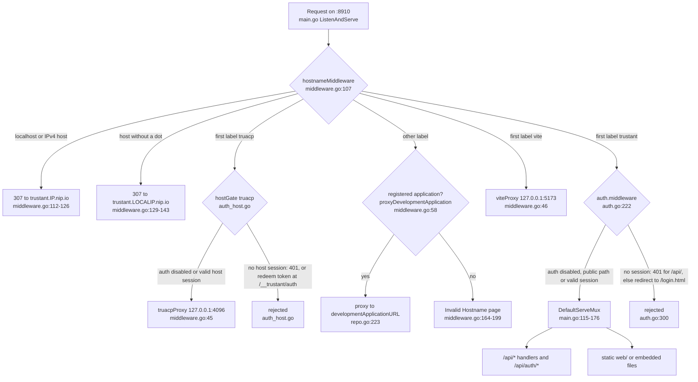

# Trustant local administrator authentication

## Scope

Trustant authentication is disabled unless `TRUSTANT_AUTH_MODE=local` is
set. Disabled mode preserves the existing UI, routes and API behaviour.

Local mode protects first-party pages and APIs served by the Trustant host on
port `8910`. It is independent from:

- generated application authentication;
- OpenServerless application users and `ops ide login`;
- model-provider and Ollama credentials;
- per-application `.env` files.

In local mode the assistant host `truacp.<domain>` has its own host-only
session (see "Assistant host session"). The Kubernetes ingress `truacp-ing`
sends it to service port `8910`, so the Go server is the only way in and applies
that check; before this change it went straight to port `4096` and bypassed it.
`vite.<domain>` (ingress to `5173`) and registered application hosts still
bypass the Trustant session middleware, on port `8910` and through the ingress.

See [trustant-auth-flow.svg](trustant-auth-flow.svg).

## Request routing

Every request on port `8910` passes `hostnameMiddleware` first, then (for the
`trustant` host only) the authentication middleware.



Text alternative: `hostnameMiddleware` redirects localhost, IP and dotless
hosts to `trustant.<ip>.nip.io`, then routes on the first hostname label.
`trustant` goes through the session check (skipped when authentication is
disabled or the path is public) to the API handlers and static UI. `truacp`
goes through the host session check to the reverse proxy on port `4096` (a
pass-through when authentication is disabled); `vite` goes straight to the proxy
on `5173` and does not pass any session check. Any other label is proxied to that application when
it is a registered repository (`getAppRepo`); otherwise the server shows an
"Invalid Hostname" page.

## Startup warning

When authentication is disabled the server logs `authWarning` before it starts
listening, and `run.sh` prints the same message in the console. The server
always listens on every interface of port `8910`; there is no bind-address
setting, so the warning does not depend on the address.

## Accepted risk: default exposure

Decision (owner, task #115, 2026-11-24): the default behaviour does not change.
Without `TRUSTANT_AUTH_MODE=local`, port `8910` is served on every interface
without login, and the following surfaces are reachable by anyone who can reach
the port:

- the `api terminal` shell, file and deploy APIs of the Trustant host;
- `truacp.<domain>` (in local mode it is protected, see below), and
  `vite.<domain>` and registered application hosts, which bypass the local
  session even when local mode is on (see Scope).

The risk is accepted for development on a trusted network, which is the
supported deployment of the default configuration. Mitigations: the startup
warning above, `TRUSTANT_AUTH_MODE=local` for any shared or exposed host, and
network-level controls (firewall, loopback-only port publishing, private
network) for the proxied hosts. Revisit the decision if a bind-address setting
is introduced or host sessions are extended to `vite` and application hosts.

## Assistant host session

Decision (owner, task #4, 2026-11-26): with `TRUSTANT_AUTH_MODE=local`, the
assistant host `truacp.<domain>` requires a session of its own. With
authentication disabled nothing changes.

Flow:

1. The signed-in UI (`web/app.html`) calls `POST /api/auth/host-token` with
   `{"host":"truacp"}`. The call needs the session and the CSRF header. Only
   `truacp` is accepted; any other host is a 400. The token is random, valid
   for one minute, single use, and bound to the session and to that host (at
   most 256 pending tokens).
2. The UI loads the assistant frame at
   `<truacp host>/__trustant/auth?token=<token>&next=%2F`.
3. `hostGate` redeems the token on the proxied host, sets the cookie
   `trustant_host_session` (`__Host-trustant_host_session` over HTTPS) and
   redirects to `next`, which is kept to a local path (anything else becomes `/`).

The cookie is host-only (no `Domain`), `HttpOnly`, and its signature covers the
host label. The assistant is an iframe of the trustant host, and a `Strict`
cookie is dropped in that frame when the two hosts are different sites (for
example `*.localhost`, or a public-suffix domain such as nip.io). So over HTTPS,
or on `localhost` and `*.localhost` (secure contexts for browsers), the cookie is
`Secure; SameSite=None; Partitioned` (CHIPS): it is stored and sent only inside
this embedding, never to other sites. Over plain HTTP on any other name it stays
`SameSite=Strict`, which works only when both hosts share a registrable domain;
elsewhere the assistant frame shows the 401 page (use HTTPS or `*.localhost`).
Because the signature covers the label, the trustant session cookie value is not
accepted on the assistant host and the reverse. It points at the same server
session: logging out, expiry (eight hours) or a restart close the assistant host
too. Requests without a valid cookie get a 401 page that links to the login
host. The cookie is removed from the request before it is proxied to TruACP.

HTTP and WebSocket both pass the gate. A WebSocket handshake that carries an
`Origin` different from the host is refused with 403; a handshake without
`Origin` is a non-browser client and is allowed once it has the cookie.

Limits: the check does not apply to `vite.<domain>` or application hosts;
port `4096` itself is still a cluster service port and anything that reaches it
inside the cluster is not checked; an application host on the same domain can
set cookies for the parent domain (cookie tossing), which the host-prefixed
cookie name only resists over HTTPS.

Tests: `auth_host_test.go` covers the disabled pass-through, the full token and
cookie flow, single use, expiry, host binding, open-redirect handling,
WebSocket origin, cookie stripping, logout, and the routing in
`hostnameMiddleware`.

## Configuration

Local mode requires three explicit values. Each value may be supplied directly
or through the corresponding `_FILE` variable. `_FILE` takes precedence.

| Value | Direct environment | File environment |
| --- | --- | --- |
| Username | `TRUSTANT_AUTH_USERNAME` | `TRUSTANT_AUTH_USERNAME_FILE` |
| Password hash | `TRUSTANT_AUTH_PASSWORD_HASH` | `TRUSTANT_AUTH_PASSWORD_HASH_FILE` |
| Session key | `TRUSTANT_AUTH_SESSION_KEY` | `TRUSTANT_AUTH_SESSION_KEY_FILE` |

The password hash format is:

```text
pbkdf2-sha256$<iterations>$<base64-salt>$<base64-derived-key>
```

Iterations must be between `100000` and `2000000`; generated hashes should use
`210000` or more. The salt must contain 16-1024 bytes and the derived key 32-64
bytes. The session key must contain at least 32 bytes. A session key prefixed
with `base64:` is decoded before use.

Missing or invalid local-mode configuration is a startup error. Credentials
must come from an operator-managed Secret mount or explicit process environment
and must never be copied into workspace configuration, generated applications,
app environment maps or `ops ide login` configuration.

## HTTP contract

Public resources in local mode are limited to the login page and its static
assets, `POST /api/auth/login`, `GET /api/version`, and `GET /api/status`.
Unauthenticated page requests redirect to `/login.html?next=<path>`. Protected
API requests return HTTP `401` JSON.

Authentication endpoints:

- `POST /api/auth/login` accepts `{ "username": "...", "password": "..." }`;
- `GET /api/auth/session` returns the username, expiry and CSRF token;
- `POST /api/auth/logout` invalidates the server session and clears cookies.

Login requires a same-origin `Origin` header and is rate limited by the
transport peer address. Forwarded client-address headers are ignored unless
`TRUSTANT_AUTH_TRUSTED_PROXIES` lists the proxies in front of Trustant
(comma-separated IPs or CIDR ranges, for example the ingress controller's pod
range). For a request from a listed peer, the limiter key is the right-most
`X-Forwarded-For` address that is not itself a listed proxy; a malformed header
falls back to the peer, and `X-Real-IP` is never used. Behind an ingress without
this setting all clients share one bucket, so five failed logins lock everyone
out. An invalid list stops startup.
The response creates an opaque, signed, host-only cookie with `HttpOnly`,
`SameSite=Strict`, `Path=/`, and `Secure` whenever the external request uses
HTTPS. Sessions are stored only in memory, expire after eight hours, are
bounded to 256 entries, and are invalidated by a server restart.

`web/trustant-auth.js` wraps first-party `fetch` calls and adds
`X-Trustant-CSRF` to mutating and effectful requests. The server requires both
the session CSRF value and same-origin request evidence (`Origin`, or `Referer`
when browsers omit `Origin` on a same-origin GET) for:

- every method other than `GET`, `HEAD`, and `OPTIONS`;
- `GET /api/launch/<app>`;
- `GET /api/configure`;
- `GET /api/ollama-connect`;
- `GET /api/redeploy`.

Login is the only exception because no session exists yet; it still requires a
same-origin `Origin`. API clients must obtain a session and send the CSRF header
explicitly.

## Security properties and limits

- Session identifiers are random and authenticated with HMAC-SHA256 using the
  configured session key.
- Password verification uses PBKDF2-HMAC-SHA256 and constant-time comparison.
- Failed login state is bounded and old entries are removed automatically.
- Successful authentication rotates to a new session and clears the rate-limit
  bucket for that client.
- Logout invalidates server state, so a copied cookie cannot be reused.
- Authentication does not provide authorization roles; local mode is a single
  administrator boundary.
- HTTP deployments cannot provide confidentiality. Production exposure should
  terminate HTTPS so the `Secure` cookie form is used.

## Tests

Unit tests cover disabled compatibility, configuration loading, password hash
validation, login throttling, cookie flags, bounded/expiring sessions, page/API
authentication, CSRF on normal mutations and effectful GET routes, and logout.

## Development-mode stream

Authentication must be a deployment choice, not an implicit dependency of an
image or Git branch. A development deployment must be able to run with
`TRUSTANT_AUTH_MODE=disabled` without a reachable Keycloak, OIDC discovery,
OIDC Secret, or auth-specific volume. Switching between `main`, `devel`, and a
local image must preserve the explicitly selected mode and must not leave an
incompatible mode from a previous image active.

Implementation phases:

1. Add an installer/deployment setting with the explicit values `disabled`,
   `local`, and `oidc`; development installs default to `disabled` and
   production does not silently fall back from `oidc` after an OIDC error.
2. Render only the environment variables, Secret mounts, and volumes required
   by the selected mode. Changing to `disabled` removes stale OIDC deployment
   configuration but does not delete the operator-owned Kubernetes Secret.
3. Expose the same setting in the Trustant configuration UI after the
   deployment API can apply it safely. Enabling `oidc` requires validated
   Keycloak configuration before rollout; disabling it requires explicit user
   confirmation because it changes the access boundary.
4. Add rollout E2E coverage for `disabled -> oidc -> disabled`, including an
   unavailable Keycloak, branch/image changes, and verification that no auth
   value reaches generated application `.env` files.

The current local cluster demonstrated the required compatibility behavior:
the public `main` image predates OIDC and failed to start while the StatefulSet
still supplied `TRUSTANT_AUTH_MODE=oidc`. Setting the deployment explicitly to
`disabled` restored the server without changing the image or requiring
Keycloak. The final implementation must make this transition a supported,
idempotent product operation rather than a manual `kubectl set env` command.
